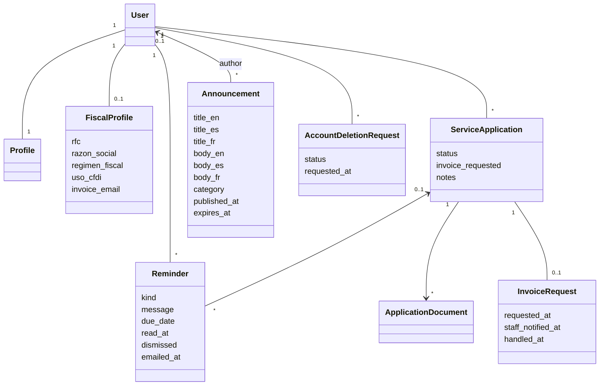

# Galiel data model (Mermaid UML)

## Flow
- Admin status updates -> on-commit reminder creation and email.
- Cron -> due date window + emailed_at idempotence -> SMTP.
- Client endpoints -> filtered by request.user -> render/POST updates.
- Database -> private snapshot; uploads -> daily private tar archive.
- No automatic invoice generation or Stripe checkout.
