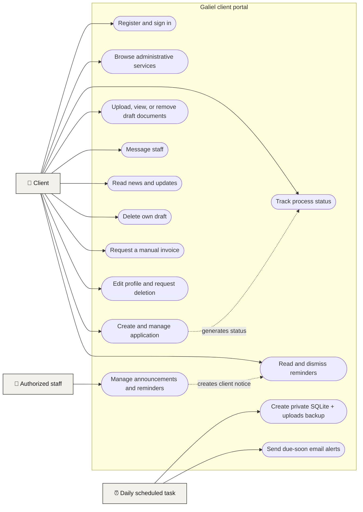
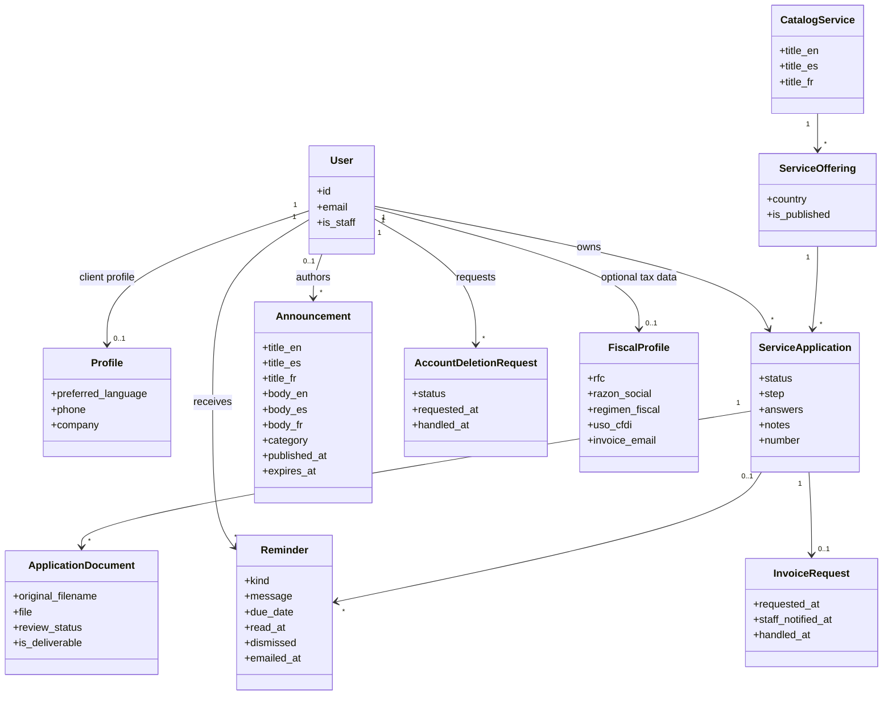
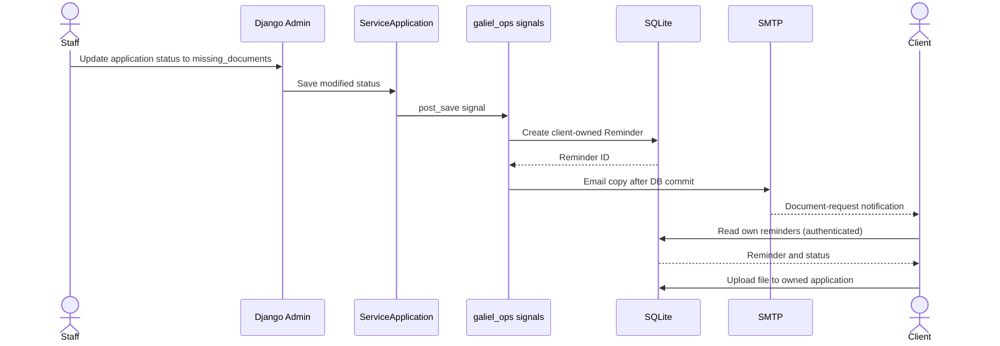

# Galiel — UML and system interactions

All diagrams describe the deployed client-portal functionality. Payments and fee-import automation are intentionally on hold.

## Use-case diagram (Mermaid)

## Class diagram

## Sequence diagram: staff requests a document

## Security boundaries

Private application, document, reminder and invoice-request queries must always be scoped to the authenticated owner. Staff-only administration uses Django staff permissions. A missing/expired announcement is excluded by publication windows. The daily backup command only archives an allowlisted set of private upload directories.
